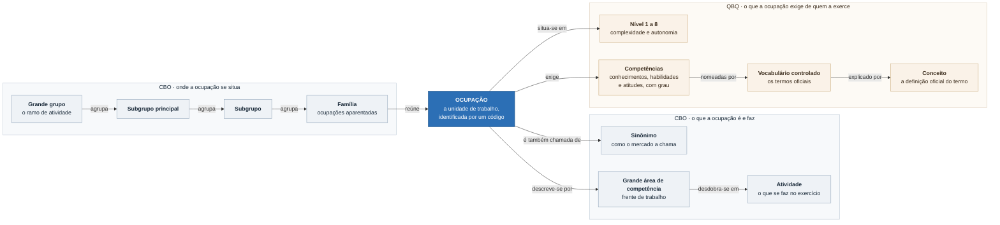

# Dados Abertos da CBO e QBQ

**O Quadro Brasileiro de Qualificações (QBQ) e a Classificação Brasileira de Ocupações (CBO) como dados abertos, estruturados e verificáveis.**

Os dados oficiais existem — mas espalhados em planilhas XLSX, sistemas de consulta e PDFs, sem formato canônico legível por máquina, sem histórico e sem proveniência. Este repositório resolve isso, nos moldes do [bncc-dados](https://github.com/bncc-dev/bncc-dados): JSON canônico com proveniência por registro, pipeline reprodutível e derivados prontos para uso (CSV e SQLite).

## O que tem aqui (versão `dados-2026.11.2`)

| Conjunto | Conteúdo | Onde |
|---|---|---|
| Espinha CBO | 10 grandes grupos → 49 subgrupos principais → 195 subgrupos → 626 famílias → 2.694 ocupações | `dados/cbo/estrutura/`, `dados/cbo/ocupacoes/` |
| Sinônimos CBO | 7.778 denominações alternativas, em 1.865 ocupações | embutidos na ocupação |
| Perfil ocupacional CBO | 174.296 atividades em 20.723 grandes áreas de competência, para 2.669 ocupações | `dados/cbo/perfis/` |
| Ocupações QBQ | 2.673 ocupações (2.621 com síntese, perfil ocupacional e níveis de qualificação 1–8) | `dados/qbq/ocupacoes/` |
| Competências (CHA) | ~258 mil itens de conhecimento, habilidade e atitude por ocupação, com graus de profundidade, frequência e importância (1–5) | `dados/qbq/competencias/` |
| Vocabulários | Taxonomias controladas de conhecimentos (I e II), habilidades e atitudes | `dados/qbq/vocabularios/` |
| Conceitos | 96 definições oficiais de domínios, categorias e habilidades (PDF de conceitos e terminologia) | `dados/qbq/conceitos/` |
| Não classificadas | 52 ocupações sem nível QBQ, com a justificativa oficial | `dados/qbq/nao-classificadas.json` |
| Derivados | Os mesmos dados em CSV e SQLite, gerados pelo pipeline | `derivados/` |

As duas camadas compartilham a chave (código CBO de 6 dígitos) e **divergem em 64 ocupações**: 25 existem só na CBO, 4 só no QBQ e 35 têm título diferente sob o mesmo código. Nenhuma é reconciliada — ver [`docs/cobertura-qbq-cbo.md`](docs/cobertura-qbq-cbo.md) e o D015.

Os Livros em PDF da CBO e o histórico de alterações são as fases seguintes — ver roadmap abaixo.

## Como citar

Fernandes, W. (2026). *cbo-qbq-dados: Classificação Brasileira de Ocupações e Quadro Brasileiro de Qualificações como dados abertos* (Versão dados-2026.11.2) [Conjunto de dados]. Zenodo. Licença CC BY 4.0.

```bibtex
@dataset{fernandes_cbo_qbq_dados_2026,
  author    = {Fernandes, Wil},
  title     = {cbo-qbq-dados: Classificação Brasileira de Ocupações e Quadro Brasileiro de Qualificações como dados abertos},
  year      = {2026},
  publisher = {Zenodo},
  version   = {dados-2026.11.2},
  url       = {https://cbo.ciencia.social}
}
```

O DOI de versão fixa o conjunto que foi usado; o DOI de conceito aponta para a versão mais recente. Os dois entram nesta citação quando o depósito Zenodo de `dados-2026.11.2` for publicado; até lá os campos ficam vazios.

## Onde consultar

Os mesmos dados estão servidos para navegação em [https://cbo.ciencia.social](https://cbo.ciencia.social). A API REST é aberta, sem chave, em [https://cbo.ciencia.social/api/v1](https://cbo.ciencia.social/api/v1). O servidor MCP está em [https://cbo.ciencia.social/mcp](https://cbo.ciencia.social/mcp). A API e o MCP servem a versão fixada desta publicação; qual é ela está em [https://cbo.ciencia.social/api/v1/versao](https://cbo.ciencia.social/api/v1/versao).

## Como os dados se encaixam

O centro do modelo é a **ocupação**: a unidade de trabalho que a CBO identifica por um código de seis dígitos. É dela que se sobe para a classificação e se desce para o que o trabalho exige de quem o exerce — e é ela que permite usar as duas fontes oficiais na mesma consulta.



**Onde a ocupação se situa.** A hierarquia da CBO é posicional: cada nível é um prefixo do código. O `212405` (analista de desenvolvimento de sistemas) pertence à família `2124`, ao subgrupo `212`, ao subgrupo principal `21` e ao grande grupo `2`, sem precisar de tabela de ligação.

**O que a ocupação é e faz.** Ainda na CBO, cada ocupação carrega seus sinônimos — as denominações pelas quais o mercado a chama — e seu perfil ocupacional: grandes áreas de competência, que são as frentes de trabalho da ocupação, cada uma desdobrada nas atividades que se executam ali.

**O que a ocupação exige.** O QBQ parte da mesma ocupação e a qualifica: situa-a em um nível de 1 a 8, que expressa a complexidade e a autonomia do trabalho, e lista as competências necessárias — conhecimentos, habilidades e atitudes, cada um com seu grau. Esses itens não são texto livre: cada um aponta para um termo de vocabulário controlado, e os termos de habilidade têm sua definição oficial na camada de conceitos.

As duas fontes se complementam em vez de competir: a CBO descreve o trabalho em atividades observáveis, o QBQ gradua o que ele exige de quem o executa. A ponte é o código da ocupação, e é por isso que uma consulta só percorre o caminho inteiro:

```sql
-- da atividade concreta à competência exigida, com a definição oficial
SELECT a.descricao AS atividade, c.termo AS habilidade, h.importancia, c.conceito
FROM cbo_atividade a
JOIN qbq_habilidade h ON h.ocupacao = a.ocupacao
JOIN qbq_conceito  c  ON c.codigo = h.item AND c.nivel = 'habilidades'
WHERE a.ocupacao = '212405' AND h.importancia = 5;
```

O diagrama é conceitual: mostra o que cada elemento é e como se liga aos outros. As contagens de cada conjunto estão na tabela acima, e as ressalvas de cobertura entre as duas camadas, em [`docs/cobertura-qbq-cbo.md`](docs/cobertura-qbq-cbo.md).

## Uso rápido

```python
import json
# ocupações do grande grupo 3 (técnicos de nível médio)
gg3 = json.load(open("dados/qbq/ocupacoes/gg-3.json", encoding="utf-8"))
tecnico = next(o for o in gg3["ocupacoes"] if o["codigo"] == "312105")
print(tecnico["titulo"], "->", tecnico["niveis"]["qualificacao"])
```

```sql
-- qbq.sqlite (anexo do release, ou `python3 pipeline/derivar.py`):
-- do nome de mercado ao código oficial, com o nível de qualificação do QBQ
SELECT s.sinonimo, o.codigo, o.titulo, q.nivel_qualificacao
FROM cbo_sinonimo s
JOIN cbo_ocupacao o      ON o.codigo = s.ocupacao
LEFT JOIN qbq_ocupacao q ON q.codigo = o.codigo
WHERE s.sinonimo LIKE '%programador%'
ORDER BY s.sinonimo;
```

Mais 13 consultas comentadas — hierarquia completa, perfil CHA com a definição oficial de cada termo, agregados por grande grupo, divergências entre as camadas, atividades do perfil e similaridade entre ocupações — em [`docs/consultas.sql`](docs/consultas.sql):

```bash
sqlite3 -box derivados/qbq.sqlite < docs/consultas.sql
```

## Estrutura do repositório

```
fontes/      arquivos oficiais imutáveis, como baixados (com checksum)
schema/      JSON Schemas (draft 2020-12) que definem o contrato dos dados
dados/       dados canônicos em JSON — a fonte de verdade deste repositório
derivados/   CSV, SQLite e dump SQL gerados a partir de dados/ (nunca editar)
pipeline/    scripts que extraem, validam e derivam (ver pipeline/README.md)
docs/        modelo de dados, fontes oficiais, metodologia e versionamento
```

Pontos de modelagem que valem conhecer antes de usar (detalhes em [docs/modelo-de-dados.md](docs/modelo-de-dados.md)):

- O **código CBO de 6 dígitos** (`"312105"`, com zero à esquerda) é a chave primária de tudo e será a chave de junção com a CBO na fase 1.
- O QBQ usa **duas taxonomias de conhecimento distintas**: `conhecimentos-i` para ocupações de nível 1–5 e `conhecimentos-ii` (com elementos, tipo CNPq) para níveis 6–8.
- Cobertura parcial é dado explícito: o que não tem nível QBQ está em `nao-classificadas.json` com a justificativa oficial.
- Registros carregam `vigencia` e `fonte` (arquivo/aba/linha da planilha oficial) — nada aqui é inventado, tudo é rastreável.

## Reproduzir

```bash
pip install openpyxl jsonschema
python3 pipeline/extrair_qbq.py && python3 pipeline/validar_schema.py \
  && python3 pipeline/validar.py && python3 pipeline/derivar.py
```

## Roadmap

- [x] **Fase 0-2 — QBQ**: fontes, schemas, ocupações, competências CHA, vocabulários e conceitos das habilidades
- [x] **Fase 1 — espinha CBO**: estrutura enumerativa completa (grandes grupos → ocupações → sinônimos) a partir dos CSVs oficiais da CBO
- [x] **Fase 3 — perfil ocupacional CBO**: grandes áreas de competência e atividades por ocupação
- [ ] **Fase 3b — Livros 1–3 em PDF**: condições gerais de exercício e recursos de trabalho, por família
- [ ] **Fase 4 — histórico de alterações** da CBO como dado estruturado (`alteracoes.json` + vigência retroativa)
- [ ] **Fase 5 — `qbq-pacotes`**: pacotes Python/R/JS para consumo

## Licenças

- **Dados** (`dados/`, `derivados/`): [CC BY 4.0](dados/LICENSE.md), identificador SPDX `CC-BY-4.0`. O conteúdo provém de atos oficiais (art. 8º, IV, Lei 9.610/1998); a compilação estruturada é licenciada abertamente.
- **Código** (`pipeline/`, `schema/`): [MIT](LICENSE), identificador SPDX `MIT`.

Atribuição: Fernandes, W. (2026). *cbo-qbq-dados: Classificação Brasileira de Ocupações e Quadro Brasileiro de Qualificações como dados abertos* (Versão dados-2026.11.2) [Conjunto de dados]. Zenodo. Licença CC BY 4.0.

Decisões de modelagem e inconsistências encontradas nas fontes ficam registradas em [DECISOES.md](DECISOES.md).
