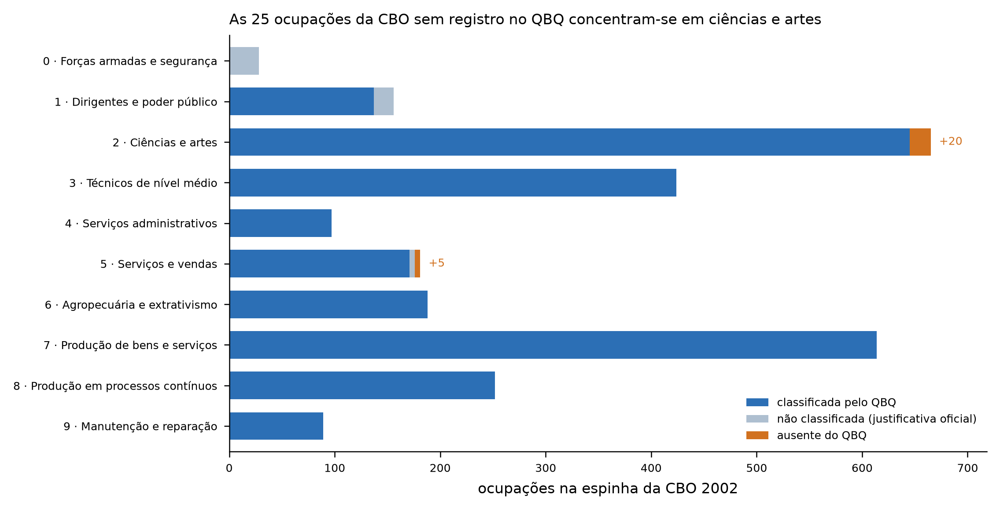

# Cobertura QBQ × CBO

Confronto entre as duas camadas do dataset na mesma chave, o código CBO de seis
dígitos. A espinha da CBO foi capturada em 2026-11-17; a planilha do QBQ é a
versão modificada em 2025-03-18. **As duas são oficiais e divergem** — esta
página descreve como, sem reconciliar nenhuma delas (D015).

Números regenerados pelo pipeline; a lista completa, máquina a máquina, está em
`derivados/csv/cobertura-qbq-cbo.csv`.

## Panorama

| conjunto | ocupações |
|---|---|
| espinha da CBO | 2.694 |
| registros do QBQ | 2.673 |
| ├ classificadas (com níveis) | 2.621 |
| └ não classificadas (justificativa oficial) | 52 |
| presentes nas duas camadas | 2.669 |
| só na CBO | 25 |
| só no QBQ | 4 |
| mesmo código, títulos diferentes | 35 |

## As 25 ocupações da CBO sem registro no QBQ

Vinte delas estão no grande grupo 2 (profissionais das ciências e das artes) e
formam **sete famílias inteiras**, sem nenhuma ocupação classificada pelo QBQ:

| família | título | ocupações |
|---|---|---|
| 2511 | Profissionais em pesquisa e análise antropológica e arqueológica | 4 |
| 2512 | Economistas | 7 |
| 2513 | Profissionais em pesquisa e análise geográfica | 1 |
| 2514 | Filósofos | 1 |
| 2516 | Assistentes sociais e economistas domésticos | 2 |
| 2521 | Administradores | 1 |
| 2544 | Fiscais de tributos estaduais e municipais | 4 |

As cinco restantes estão em duas famílias que o QBQ cobre parcialmente:
`516145` Designer de unhas, `516150` Designer de sobrancelhas, `516155` Designer
de cílios (família 5161, embelezamento), `517230` Policial penal e `517235`
Guarda portuário (família 5172, segurança).

## As 4 ocupações do QBQ fora da espinha da CBO

| código | título no QBQ |
|---|---|
| 516140 | Pedicure |
| 517315 | Agente de segurança penitenciária |
| 517335 | Guarda portuário |
| 722225 | Operador de máquina de fundir sob pressão |

**Leitura, não fato apurado:** três dessas quatro parecem ter sido substituídas
na CBO por códigos novos com denominação atualizada — "Agente de segurança
penitenciária" (517315) por "Policial penal" (517230), "Guarda portuário"
remunerado de 517335 para 517235, e "Pedicure" (516140) pelos três códigos de
designer da família 5161. Confirmar isso exige o histórico de alterações da CBO
(fase 4), que diz o que mudou e quando. Até lá, nenhum dos dois lados é
reescrito: ambos ficam como as fontes os publicam.

## Títulos diferentes no mesmo código

Em 35 ocupações o código coincide e o título não, comparando sem acento, caixa
nem pontuação. A maior parte é diferença de grafia ou de número gramatical, e
algumas são erro de digitação de um dos lados:

| código | CBO | QBQ |
|---|---|---|
| 333105 | Instrutor de auto-escola | Instrutor de autoescola |
| 351415 | Escrivão extra - judicial | Escrivão extrajudicial |
| 354150 | Propagandista de produtos famacêuticos | Propagandista de produtos farmacêuticos |
| 377235 | Árbitro de karatê | Árbitro de caratê |
| 342560 | Operador de rampa ( transporte aéreo) | Líder de rampa (transporte aéreo) |

As duas últimas linhas mostram os dois tipos: variação de grafia (karatê/caratê)
e denominação de fato diferente (operador/líder de rampa). O dataset preserva as
duas e deixa a escolha para quem consome — a camada CBO responde pelo título da
classificação, a camada QBQ pelo título como a planilha de qualificações o
registra.
