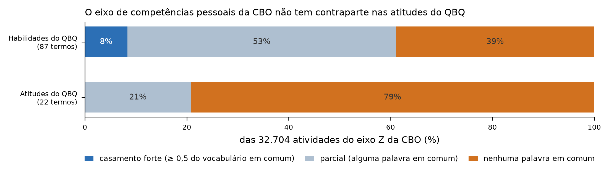

# O eixo Z da CBO e as atitudes do QBQ

O perfil ocupacional da CBO reserva a sigla `Z` — "demonstrar competências
pessoais" — para o que não é tarefa técnica: 32.704 atividades em 2.666 das
2.669 ocupações com perfil. O QBQ tem uma dimensão com nome parecido,
"atitudes". Esta página confronta as duas e mostra que **elas não falam da
mesma coisa**.

## O que cada fonte chama de atitude

As 22 atitudes do QBQ formam uma escala de autonomia e responsabilidade, em
quatro categorias: trabalho sob supervisão direta, autonomia no próprio
trabalho, supervisão do trabalho de outros e avaliação de trabalho. Os termos
são graduações — "autonomia na execução das tarefas que lhe foram atribuídas",
"supervisão de profissionais em contextos de trabalho complexos" — atadas ao
nível de qualificação da ocupação.

O eixo Z da CBO é um catálogo de comportamentos observáveis, com 3.285
descrições distintas: "trabalhar em equipe" (1.305 ocupações), "demonstrar
criatividade" (783), "demonstrar iniciativa" (570), "demonstrar flexibilidade"
(390), "demonstrar capacidade de liderança" (317).

## Medida

Para cada descrição do eixo Z, o melhor casamento com o vocabulário do QBQ, por
sobreposição de vocabulário (índice de Jaccard sobre os radicais de 5 letras
das palavras de conteúdo), ponderado pelo número de ocorrências:

| | casamento forte (≥ 0,5) | parcial | nenhuma palavra em comum |
|---|---|---|---|
| contra as 87 habilidades | 2.729 (8,3%) | 17.247 (52,7%) | 12.728 (38,9%) |
| contra as 22 atitudes | 7 (0,0%) | 6.792 (20,8%) | 25.905 (79,2%) |

A medida é lexical e portanto um **piso**: ela encontra "trabalhar em equipe" ↔
`TRABALHO EM EQUIPE` e "demonstrar raciocínio analítico" ↔ `RACIOCÍNIO
ANALÍTICO`, mas não reconhece sinonímia sem palavra em comum. A banda parcial
mistura casamento real com coincidência de palavra genérica ("capacidade",
"trabalho") e não deve ser lida como correspondência.

## O que a comparação mostra

O eixo Z tem correspondência com as **habilidades** do QBQ, não com as
atitudes: a dimensão que o QBQ chama de atitude é escala de autonomia, e não
catálogo de comportamento. Onde a CBO diz "demonstrar destreza manual", o QBQ
tem a habilidade `DESTREZA MANUAL`; onde a CBO diz "trabalhar sob pressão", o
QBQ tem `OUTRAS - TRABALHO SOB PRESSÃO`.

Mais informativo é o que não casa com nada. Entre as atividades mais frequentes
do eixo Z sem uma única palavra em comum com qualquer termo do QBQ estão
"demonstrar criatividade", "demonstrar iniciativa", "tomar decisões",
"demonstrar paciência", "demonstrar empatia" e "demonstrar liderança". A busca
direta confirma: **criatividade, iniciativa, liderança, empatia, paciência,
tomada de decisão e ética não aparecem em nenhum termo** dos vocabulários de
habilidades ou de atitudes do QBQ. Não é limitação da medida — é ausência.

Há ainda diferença de granularidade: "comunicar-se", que a CBO lista como uma
atividade, corresponde no QBQ a uma categoria inteira (`COMUNICAÇÃO`), com dez
habilidades dentro — compreensão oral, expressão escrita, escuta ativa,
persuasão, negociação e outras.

As duas fontes, portanto, são **complementares e não redundantes**: a CBO
descreve disposições observáveis no exercício da ocupação; o QBQ gradua
autonomia e responsabilidade por nível de qualificação. Quem precisar de perfil
comportamental completo precisa das duas, e nenhuma consulta de junção deve
tratar `cbo_atividade` com sigla `Z` como equivalente de `qbq_atitude`.
